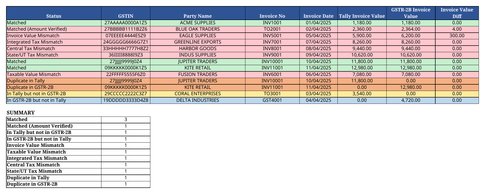

# GST Reconciler

A desktop application for reconciling a **Tally Voucher Register** with **GSTR-2B** data downloaded from the Indian GST portal. It automatically flags mismatches (invoice value, taxable value, IGST/CGST/SGST) and exports a color‑coded reconciliation report that preserves all original sheets in the GSTR-2B file.

[](https://www.python.org/downloads/)
[](https://github.com/gsraj0301/gst-reconciler/actions/workflows/test.yml)


## What it does

Reconciles your internal **Tally voucher data** against the **GSTR‑2B** auto‑generated purchase register from the GST portal. The app matches invoices by GSTIN + invoice number + party name, tolerates small value differences (≤ ₹10), and produces a single Excel report highlighting every match / mismatch / duplicate — ready for audit or filing.

## Features

- **Drag‑and‑drop file upload** for both Tally and GSTR-2B Excel files
- **Three‑tier matching logic** (priority order):
  1. **GSTIN + Amount** — same GSTIN and taxable value within ₹10 → **Matched** when invoice number and party also match, otherwise **Matched (Amount Verified)**; tax‑head differences are still flagged
  2. **Exact 3‑key match** — `GSTIN + Invoice No + Party Name` → paired, differences flagged
  3. **Fallbacks** — duplicates, “in‑only” categories, and value‑only mismatches
- **Matched statuses**: Matched / Matched (Amount Verified)
- **Nine mismatch categories**:
  - In Tally only
  - In GSTR‑2B only
  - Invoice Value Mismatch (>₹10)
  - Taxable Value Mismatch (>₹10)
  - Integrated Tax (IGST) Mismatch (>₹10)
  - Central Tax (CGST) Mismatch (>₹10)
  - State/UT Tax (SGST) Mismatch (>₹10)
  - Duplicate in Tally
  - Duplicate in GSTR‑2B
- **Click any mismatch row** to view filtered details in a side‑by‑side comparison view
- **Download report** — modified copy of the GSTR‑2B file with a new first sheet named **"Reconciliation Report"**, preserving all original sheets
- **Handles 250MB+ files** (desktop app, no upload limits)
- **Supports varying column names** (Tally sheet can be `CGST Input` or `PURCHASE REGISTER`; column aliases are mapped automatically)
- **Color‑coded output**:
  - 🟢 Green = Matched
  - 🟡 Yellow = In Tally only
  - 🔵 Blue = In GSTR‑2B only
  - 🔴 Red = Mismatches
  - 🟠 Orange = Duplicates

## Requirements

- **OS:** Windows 10/11 (64‑bit) for pre‑built executable
- **Or:** Run from source with Python **3.10+**
- **Dependencies:** `pandas`, `openpyxl`, `tkinterdnd2`, `pyinstaller` (see `requirements.txt`)

## Installation

### Option 1: Pre‑built executable (recommended)

1. Download `GST-Reconciler.exe` from the **Releases** page
2. Double‑click to run

### Option 2: From source

```bash
# Clone the repo
git clone https://github.com/gsraj0301/gst-reconciler.git
cd gst-reconciler

# Create a virtual environment (recommended)
python3 -m venv .venv
source .venv/bin/activate    # Windows: .venv\Scripts\activate

# Install dependencies
pip install -r requirements.txt

# Launch the app
python run.py
```

## Usage

1. **Launch** the app — it opens directly on the upload screen
2. **Upload files** — either drag‑and‑drop an Excel file onto the card, or click **Browse**
   - **Tally file** (.xlsx) — must contain a sheet named `CGST Input` (or `PURCHASE REGISTER`)
   - **GSTR‑2B file** (.xlsx) — must contain a sheet named `B2B` (the parser auto‑detects two‑row merged headers)
3. Click **Start Reconciliation**
4. **View results** — summary table with counts per mismatch category
5. **Double‑click any row** in the summary to open the detail view (shows full invoice data side‑by‑side)
6. **Click "Download Report"** to save the reconciled GSTR‑2B file (original sheets kept intact)

## Sample Reconciliation

The [`sample/`](sample/) folder contains deterministic, fully synthetic files with no real taxpayer data. The sample covers both matched statuses and all nine mismatch categories; expected counts are in [`sample/expected_summary.json`](sample/expected_summary.json).



Open [`sample/reconciliation-report.xlsx`](sample/reconciliation-report.xlsx) to inspect the full color‑coded report.

## File Format Requirements

### Tally Voucher Register

- **Sheet name:** `CGST Input` *or* `PURCHASE REGISTER`
- **Required columns** (order‑independent): Date, Particulars, Voucher Type, Voucher No., Voucher Ref. No., Voucher Ref. Date, GSTIN/UIN, Value, Gross Total, Taxable Value, CGST Input, SGST Input
- The app relaxes header detection — it will work with variations like `Supplier Invoice No.` instead of `Voucher Ref. No.`

### GSTR‑2B (from GST Portal)

- **Sheet name:** `B2B`
- **Required columns** (order‑independent): GSTIN of supplier, Trade/Legal name, Invoice number, Invoice type, Invoice Date, Invoice Value(₹), Place of supply, Supply Attract Reverse Charge, Taxable Value (₹), Integrated Tax(₹), Central Tax(₹), State/UT Tax(₹), Cess(₹)
- The parser auto‑detects the two‑row header structure (main + sub‑headers) used by the GST portal

## Matching Logic (Priority Order)

| Tier | Rule |
|---|---|
| **Primary — GSTIN + Amount** | Same GSTIN AND taxable value within **₹10** → **Matched** if invoice number and party also match, otherwise **Matched (Amount Verified)** (tax‑head differences still flagged) |
| **Secondary — Exact 3‑key match** | `clean(GSTIN) + clean(Invoice No) + clean(Party Name)` exact → paired, differences flagged |
| **Fallbacks** | Same key as already‑matched entry → “Duplicate in Tally” / “Duplicate in GSTR‑2B” |
| | GSTIN exists in the other file but nothing aligned → “Invoice Value Mismatch; Taxable Value Mismatch” |
| | No GSTIN match at all → “In Tally but not in GSTR‑2B” / “In GSTR‑2B but not in Tally” |

### Cleaning rules

- **GSTIN:** spaces and dashes removed, uppercased
- **Invoice No:** spaces, dashes, slashes removed, uppercased
- **Party Name:** trimmed, uppercased

## Output

The modified GSTR‑2B file includes a new first sheet: **"Reconciliation Report"**

| Column | Description |
|---|---|
| Status | Matched / In Tally only / In GSTR‑2B only / Mismatch / Duplicate |
| GSTIN | Supplier GSTIN |
| Party Name | Supplier name |
| Invoice No | Invoice number |
| Invoice Date | Invoice date (dd/mm/yyyy) |
| Tally Invoice Value | Gross total from Tally |
| GSTR‑2B Invoice Value | Invoice value from GSTR‑2B |
| Invoice Value Diff | Difference (Tally – GSTR‑2B) |
| Tally Taxable Value | Taxable value from Tally |
| GSTR‑2B Taxable Value | Taxable value from GSTR‑2B |
| Taxable Value Diff | Difference (Tally – GSTR‑2B) |
| Tally IGST | Integrated tax from Tally |
| GSTR‑2B IGST | Integrated tax from GSTR‑2B |
| IGST Diff | Difference |
| Tally CGST | Central tax from Tally |
| GSTR‑2B CGST | Central tax from GSTR‑2B |
| CGST Diff | Difference |
| Tally SGST | State/UT tax from Tally |
| GSTR‑2B SGST | State/UT tax from GSTR‑2B |
| SGST Diff | Difference |
| Tally Row | Internal row index from Tally file |
| GSTR‑2B Row | Internal row index from GSTR‑2B file |

### Color coding (per‑row background)

- 🟢 Green = Matched
- 🟡 Yellow = In Tally only
- 🔵 Blue = In GSTR‑2B only
- 🔴 Red = Mismatches
- 🟠 Orange = Duplicates

A **summary section** at the bottom of the report lists counts per category.

### Building from source

```bash
pip install pyinstaller
pyinstaller GST-Reconciler.spec --clean
```

Output: `dist/GST-Reconciler.exe` (~66 MB)


### Contributing

For major changes, please open an issue first to discuss what you’d like to change.
